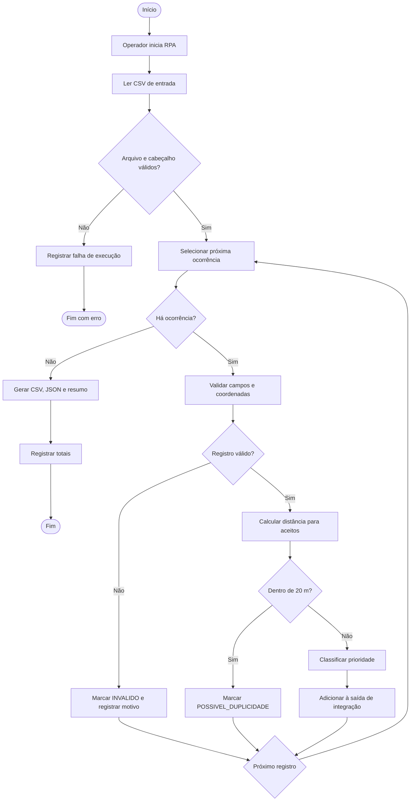

# BPMN — Fluxo do processo

Diagrama em Mermaid (também pode ser recriado no Bizagi Modeler/Draw.io para evidência visual):

## Elementos BPMN
- Evento inicial: operador dispara o processo.
- Tarefa de serviço: leitura, validação, cálculo geográfico, classificação, exportação e logging.
- Gateway exclusivo: arquivo válido, registro válido, duplicidade e continuidade do lote.
- Evento final: lote exportado ou encerrado por falha estrutural.
- Exceção por item: erro isolado é registrado e o loop continua.
