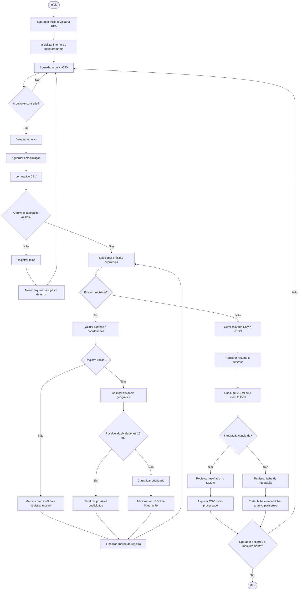

# BPMN — Fluxo do Processo VigiaVia RPA

## 1. Descrição

O processo representa o funcionamento do VigiaVia RPA desde sua inicialização até o recebimento, processamento, integração e arquivamento de arquivos CSV.

O monitoramento permanece ativo até que o operador solicite o encerramento.

## 2. Diagrama do processo

O diagrama abaixo utiliza Mermaid como representação visual do fluxo. Para uma entrega que exija notação BPMN formal, recomenda-se reproduzir as tarefas, eventos e gateways no Bizagi Modeler ou Draw.io.

## 3. Elementos do processo

### Eventos

- **Evento inicial:** operador inicia o VigiaVia RPA.
- **Evento intermediário de espera:** monitoramento aguarda novos arquivos.
- **Evento final:** operador encerra o monitoramento.

### Tarefas

- Inicializar interface gráfica.
- Monitorar pasta de entrada.
- Detectar e estabilizar arquivo.
- Ler CSV.
- Validar campos.
- Calcular distância geográfica.
- Classificar prioridade.
- Gerar relatórios.
- Consumir JSON.
- Registrar informações no SQLite.
- Arquivar arquivo original.
- Registrar logs e auditoria.

### Gateways exclusivos

- Arquivo encontrado?
- Arquivo e cabeçalho válidos?
- Existem registros?
- Registro válido?
- Possível duplicidade?
- Integração concluída?
- Operador encerrou o monitoramento?

## 4. Exceções e caminhos alternativos

- Arquivo estruturalmente inválido: registro da falha e encaminhamento para a pasta de erros.
- Registro inválido: rejeição individual e continuidade do lote.
- Possível duplicidade: sinalização sem exclusão automática.
- Falha de integração: registro do erro e tratamento pelo fluxo de exceção.
- Encerramento solicitado: finalização do monitoramento.

## 5. Resultado esperado

O processo automatiza a triagem e a organização de ocorrências viárias, permitindo processamento contínuo de arquivos e integração demonstrativa com um componente local de persistência.